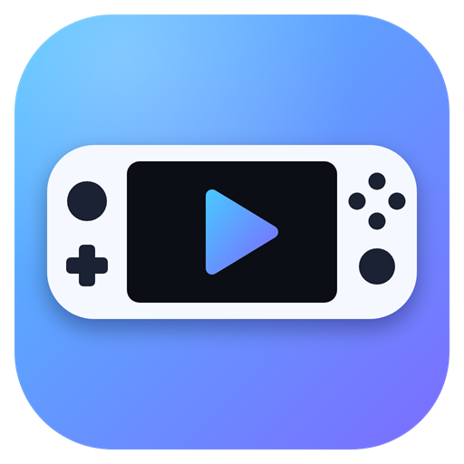

# Legion Go Media Hub



A lightweight media centre for the Lenovo Legion Go (and other Windows handhelds and tablets) that is driven
entirely by a game controller or the touchscreen. It has two small programs:

| Program | What it does |
|---|---|
| **Controller Media** | Full-screen media hub: Videos, Music, Pictures, a built-in web browser and YouTube's TV interface |
| **ControllerHome** | Tiny background helper: the Home button on a non-Xbox controller opens Xbox Game Bar |

## Controller Media

- **Two interfaces, switched automatically.** Press a controller button and you get the controller interface
  (focus ring, button hints, no touch buttons). Touch the screen and you get the touch interface (tap targets,
  Back/Home buttons, on-screen player controls).
- **Any controller SDL recognises**: XInput, DirectInput, PlayStation, Switch Pro and most third-party pads.
- **Games**: every installed Steam game appears with its cover art (read from Steam's library folders and the
  art Steam has already downloaded) and starts with one press. For games that are not on Steam, put a shortcut
  in `ControllerMedia\games`. The hub stays open behind the game and ignores the controller until it is in front
  again.
- **Game pictures**: press X on a game (or tap its ⋯ button) to look a picture up on Steam's store, choose one
  from your Pictures, or go back to the automatic one. Y on the Games screen finds pictures for every game that
  has none. Pictures you set are kept in `ControllerMedia\games` (named after the shortcut, or `steam-<id>` for a
  Steam game) and win over Steam's own art. The online search needs no account; it matches by name, so a game
  that isn't on Steam's store won't be found, and newer games may only get a landscape picture.
- **Local media** from your Videos, Music, Pictures and Downloads folders and the SD card (`D:\`).
- **Videos play through VLC's engine** (libVLC): every format VLC plays (MKV, AVI, HEVC and so on), subtitles
  (built into the file or a file with the same name next to it), several audio tracks, and VLC's own volume up
  to 200%. The app uses a copy of the engine in `ControllerMedia\vlc` if there is one (see Libraries), otherwise
  an installed [VLC media player](https://www.videolan.org/vlc/) (64-bit). It is loaded the first time a video
  is played. With neither, the browser engine's player is used (MP4 and WebM only).
- **Continue watching**: the hub remembers where each video stopped and starts it there again (a few seconds
  earlier). A video within a minute, or the last 5%, of its end counts as watched; the library shows "Watched"
  or the percentage next to each file. The home screen offers the video you stopped in, or the next episode in
  the same folder after the one you finished. Positions are kept in `ControllerMedia\progress.json` (VLC
  engine only).
- **Built-in browser** (WebView2):
  - Controller mode: left stick moves the pointer, A clicks, right stick scrolls, Y opens an on-screen keyboard,
    Start opens the browser menu. The page is full-screen.
  - Touch mode: a tablet-style bar with back, forward, reload, address bar, bookmark star, bookmarks, menu and exit.
- **YouTube TV interface** (`youtube.com/tv`), with swipes translated to arrow keys in touch mode.
- **Bookmarks**, shown as tiles on the Web page.
- **Ad blocker** with an on/off switch: blocks a built-in list of ad and tracker domains, hides leftover ad boxes,
  and strips or skips YouTube ads. YouTube changes often, so the YouTube part (`ui/adblock.js`) may need updating.
- **Volume boost up to 200%**, in 10% steps, for videos, music and web pages (including YouTube). The
  amplification follows the same curve as VLC and Linux desktops, the level cubed (110% = 1.3x, 130% = 2.2x,
  150% = 3.4x, 200% = 8x). What no longer fits is turned down by a fast limiter instead of being clipped, so
  quiet audio gets the full amplification and loud audio gets as much as fits without sounding broken. It affects
  only this app, not games or Windows. The level is remembered. In the browser menu the Volume boost row says what
  the boost is doing on the open page ("working on this page", "nothing is playing", and so on).
- **Simulated-input filter**: while the app is in front, it drops simulated mouse and keyboard input from other
  programs (for example Steam's desktop controller mode), so controller presses don't count twice. Touch, real
  keyboards and real mice are unaffected.
- **Light on resources**: the browser view is created only when a web page is opened and unloaded on exit, and
  the controller is only polled quickly while something is held. Measured on a Legion Go: about 280 MB of
  memory on the home screen and under 0.2% CPU when idle.
- **Sleeps behind games**: a few seconds after you start a game from the hub (or after half a minute behind any
  other window), and as long as nothing is playing and no web page is open, the hub lets go of the controllers
  and closes its whole browser engine. Measured: about 30 MB and no processor use while asleep, down from about
  210 MB. Coming back takes about two seconds and returns to the screen you left. A paused music queue is not
  kept across a sleep.

### Controls (controller)

| Where | Buttons |
|---|---|
| Menus | D-pad / left stick: move · A: select · B: back · −: home · X: play/pause music · LB/RB: track · LT/RT: volume (0 to 200%) · Y: search the web |
| Video | A: play/pause · ◀ ▶: 10 s · LT/RT: 1 min · ▲ ▼: volume (0 to 200%) · LB/RB: previous/next · Y: subtitles · X: audio track · B: close |
| Browser | Left stick: pointer · A: click · right stick: scroll · LT/RT: page up/down · LB/RB: zoom · Y: keyboard · Start: menu · B: back · −: exit |
| Browser menu | Volume boost: LT/RT, or ◀ ▶ on the Volume boost row (100 to 200%) |
| Keyboard | A: type · X: delete · Y: space · LS: shift · Start: go · B: cancel |

In the touch interface the video player, the now-playing bar and the browser menu have − and + volume buttons.

Buttons follow the letters printed on the controller (Nintendo and Xbox layouts are both handled).
The Home button is left alone so ControllerHome or Windows can use it.

**Capture button (Legion Go).** With the hub in front, Capture opens Lenovo's Quick Settings and gives the panel
the focus, so the controller (through Steam's desktop controls) or touch can use it; Capture again closes it and
returns to the hub. The hub does this itself because its filter drops the Ctrl+Alt+F9 that Steam sends for
Capture, and Windows' shortcut does not fire while the hub or the panel is in front. On a PC without Lenovo's
Legion Space, Capture does nothing.

**Changing the buttons.** Settings (on the home screen) lists what each button does: Select, Back, the X and Y
actions, previous/next, browser menu, home, and Shift on the on-screen keyboard. Pick a row and press the button
you want for it. If that button already did something else, the two swap, so swapping A and B takes one step.
The D-pad, sticks, triggers and Home can't be reassigned. The choice is stored by button position in
`settings.json`, applies to every controller, and "Put the buttons back to normal" undoes it. The legend at the
bottom of each screen always shows the names of the controller in use.

### Start options

- `ControllerMedia.exe --pad` starts in the controller interface even when no controller is connected.

## ControllerHome

Runs in the background with no window. When the Home/Guide button is pressed on a non-Xbox controller, it opens
Xbox Game Bar. Xbox-type controllers are skipped, because Windows already does this for them.
It writes a small `log.txt` next to the program (controllers seen and button presses).

- **Works in games that run as administrator.** Some games (for example Zenless Zone Zero and other titles with
  kernel anti-cheat) run as administrator, and Windows silently drops simulated key presses while such a window
  is in front. So ControllerHome starts the Game Bar app directly instead of simulating Win+G.
- **Capture button in administrator games (Legion Go).** Steam Input maps Capture to Ctrl+Alt+F9 for Lenovo's Quick
  Settings, but that key press is dropped in the same way. When an administrator window is in front,
  ControllerHome opens Quick Settings itself; everywhere else it leaves Capture to Steam.
- **Driving the overlays with the controller in administrator games (optional, needs administrator rights).**
  Game Bar and Quick Settings only understand keyboard, mouse, touch or an Xbox-type pad. On the desktop Steam
  turns the controller into keys and a mouse; inside a game it doesn't, and in an administrator game key presses
  from ordinary programs are dropped. If ControllerHome itself runs as administrator, it presses the keys for you
  after it opens one of them there: D-pad or left stick moves, A selects, LB/RB previous/next item, B (or Home /
  Capture again) closes. It stops after a minute without input. The game still sees the controller as well, so
  pause the game first. Set it up once with `install-admin.ps1` (see below).
- `ControllerHome.exe --gamebar` and `ControllerHome.exe --quicksettings` do that one action and exit.

### Running ControllerHome as administrator

```powershell
powershell -ExecutionPolicy Bypass -File .\install-admin.ps1              # set up, or update after a rebuild
powershell -ExecutionPolicy Bypass -File .\install-admin.ps1 -Uninstall   # back to the Startup shortcut
```

Windows asks for permission once. The script copies `ControllerHome.exe` and `SDL3.dll` to
`C:\Program Files\ControllerHome` (so the program that gets administrator rights can't be swapped by an ordinary
program), adds a scheduled task that starts it at sign-in with highest privileges, and removes the Startup
shortcut. The log is then `C:\Program Files\ControllerHome\log.txt`.

To start it with Windows, put a shortcut to `ControllerHome.exe` in the Startup folder (`shell:startup`), or use
`install-admin.ps1` above.

## Requirements

- Windows 10 or 11, 64-bit
- .NET Framework 4.8 (included with Windows; its C# compiler is used to build)
- Microsoft Edge WebView2 Runtime (included with Windows 11)
- For the VLC video engine: a `ControllerMedia\vlc` folder (see Libraries) or VLC media player 3.x, 64-bit, installed

## Libraries

The third-party libraries are not in this repository. Put them next to each program before building:

| File | Needed by | Where to get it |
|---|---|---|
| `SDL3.dll` (x64) | both | [SDL releases](https://github.com/libsdl-org/SDL/releases), `SDL3-<version>-win32-x64.zip` |
| `Microsoft.Web.WebView2.Core.dll` | Controller Media | NuGet package [Microsoft.Web.WebView2](https://www.nuget.org/packages/Microsoft.Web.WebView2), `lib\net462` |
| `Microsoft.Web.WebView2.WinForms.dll` | Controller Media | same package, `lib\net462` |
| `WebView2Loader.dll` | Controller Media | same package, `runtimes\win-x64\native` |

| `vlc\` folder (optional) | Controller Media | NuGet package [VideoLAN.LibVLC.Windows](https://www.nuget.org/packages/VideoLAN.LibVLC.Windows): copy `libvlc.dll`, `libvlccore.dll`, `plugins`, `lua` and `hrtfs` from `build\x64` into `ControllerMedia\vlc` |

The first video played with a fresh `vlc` folder takes a minute or two to start, once: VLC builds an index of its
plugins (`vlc\plugins\plugins.dat`). The folder is about 106 MB and is not kept in Git. libVLC is LGPL-licensed.

A `.nupkg` file is a zip archive: rename it to `.zip` to extract it. This project was built with WebView2 SDK
1.0.4314.35 and tested with the SDL 3 build that ships with Steam (version 3.5).

## Building

```powershell
.\build.ps1            # build both programs
.\build.ps1 -Restart   # stop the running programs, build, and start them again
```

The script uses `csc.exe` from .NET Framework, so no other tools are needed. That compiler supports C# 5 only,
so the source avoids newer syntax such as string interpolation.

## Layout

```
ControllerHome/
  src/ControllerHome.cs      the whole program
ControllerMedia/
  src/ControllerMedia.cs     window, controller input (SDL), browser, ad blocking, input filter
  ui/index.html, app.css, app.js   the interface (runs in WebView2)
  ui/adblock.js              injected into web pages while the ad blocker is on
  ui/boost.js                injected into web pages: volume boost above 100%
  ui/tvtouch.js              swipe support for youtube.com/tv
assets/
  logo.svg, logo-small.svg   the logo (detailed, and a simplified one for 16 to 24 px)
  make-icon.ps1              renders the SVGs with Edge and writes app.ico and logo.png
  app.ico, logo.png          generated; app.ico is built into ControllerMedia.exe
build.ps1
install-admin.ps1            optional: start ControllerHome as administrator at sign-in
```

Also ignored by Git: `ControllerMedia/games/` (your own game shortcuts and cover pictures) and
`ControllerMedia/vlc/` (the VLC engine).

Created at runtime and ignored by Git: `ControllerMedia/data/` (browser profile, including website sign-ins),
`ControllerMedia/settings.json` (ad blocker setting, volume, bookmarks and button choices),
`ControllerMedia/progress.json` (where each video stopped) and log files.

## Steam and the Home button

So the Home button belongs to ControllerHome and not to Steam, on this setup Steam has
"Guide button focuses Steam" and guide-button chords switched off (Settings, Controller), and Steam is started
with `-nobigpicture`, which stops it from opening in Big Picture when Home is pressed while Steam is still
starting up. That option does not block Big Picture altogether; it can still be opened from Steam's menus.

## Known limits

- Without the VLC engine, MKV and AVI files may not play; the fallback player only handles what the Edge engine
  supports (MP4, WebM and similar), and has no subtitle or audio track switching.
- In the VLC player the volume is VLC's own: below 100% it falls away faster than in the rest of the app, and
  above 100% it is VLC's plain amplification without this app's limiter.
- VLC draws with Direct3D 9 so the on-screen controls can sit on top of the picture; HDR video is shown as SDR.
- Volume boost on web pages works for streaming players (YouTube, Twitch and similar). A site that plays a media
  file straight from another domain can't be amplified and stays at normal volume. If a site ever goes silent with
  the boost on, set the boost back to 100% and reload the page.
- At high boost settings loud audio sounds compressed (quiet and loud parts end up closer together), because the
  limiter is holding it at full scale. Be careful with headphones: 200% is 8 times the signal on quiet audio.
- The Legion Go's Realtek audio processing already amplifies everything (measured about 2.9x) before the
  speakers, so with Windows volume at 100% loud videos have less room to get louder than quiet ones. Linux has
  no such processing, which is why the same boost there has clean headroom to spare.
- No browser tabs: each open tab would cost roughly 150 to 250 MB of memory.
- Without the administrator setup, Game Bar can be opened with Home but not closed with it, and in administrator
  games the overlays open but can only be used by touch.
- The Legion Go's own Legion L / Legion R buttons are handled by Lenovo's software, which does not react to them
  while a game that runs as administrator is in front. ControllerHome does not read those buttons yet.
- If Steam Input is also managing the same controller, some controllers (seen with a Switch Pro Controller over
  Bluetooth) can briefly disconnect after Home is pressed.
